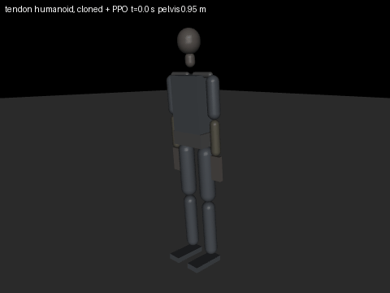
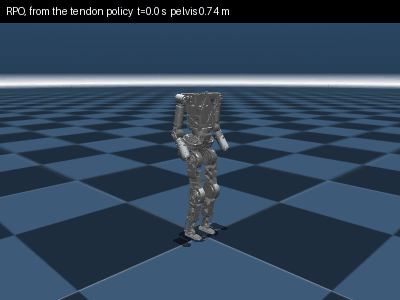
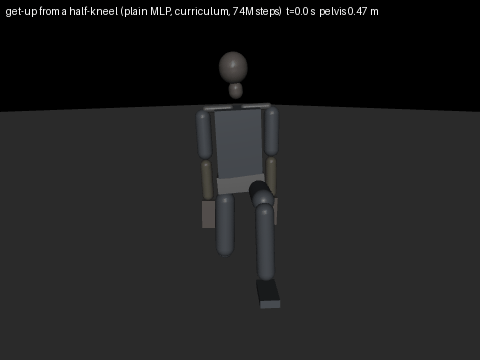

# PPO on a grounded body: the tendon humanoid's stand-in, with the model core as the actor

This is the project's first reward-driven training on a body with contact physics. The body is the tendon
humanoid of [displague/robot](https://github.com/displague/robot) (`humanoid_tendon32`); the learner is PPO;
the policy is the model core, grown from a champion checkpoint to the body's channel counts. Code:
`src/ai_embedded_dynamic_diversity/rl/`.

## The pieces

| Module | What it does |
| --- | --- |
| `rl/standin_env.py` | `StandinEnv`: N copies of the robot repository's fast stand-in (`sim/robot_standin.xml`), stepped together in MuJoCo's multithreaded rollout. Domain randomisation per model variant (servo stiffness down to half for a slack line run, damping, clutch torque, friction, link masses, pelvis mass, optionally wind), actuation delay of 0 to 2 control ticks, the damage gates, and the tasks `stand` and `getup`. |
| `rl/actor.py` | `grow_core`: the champion's core grown to the body's inputs and outputs (new encoder columns at zero, new router rows initialised as the originals were, everything else copied). `CoreActor`: the core as a Gaussian policy, its memory as the recurrent state. `Critic`, `RunningNorm`. |
| `rl/ppo.py` | Recurrent PPO in the rsl_rl recipe: GAE, clipped ratio, KL-adaptive learning rate, truncated backpropagation through each environment's window from its stored memory. |
| `rl/bc.py` | Behaviour cloning from the robot's hand-written controller (demonstrations from displague/robot `tools/record_teacher.py`), before PPO. |
| `rl/tendon_eval.py` | The gate: a trained policy run on the full tendon model, with its line, slack, clutch and power readout, against the hand-written controller on the same pushes (and, with a windy robot checkout, in head winds). |
| `rl/cli.py` | `train` and `compare` (grown versus random weights, same seed). |

## The stand-in

Each DOF's drive train (motor, self-lock, clutch, drum, two elastic line runs) is one position servo with
the line loop's stiffness, the motor's back-EMF damping and the clutch's slip torque (displague/robot
`tools/export_standin.py`). On 24 cores it runs at about 190,000 control steps per second (50 Hz control, four
5 ms physics steps each), the environment step including observations, rewards and gates at about 76,000;
PPO end to end at about 20,000 samples per second, the rest being the recurrent update on the GPU.

## Wind

Off by default. `train` and `compare` take `--wind-mean lo,hi` and `--wind-gust lo,hi` (m/s) and `--wind-tau`
(s, default 2); `EnvConfig` has the same as `wind_mean`, `wind_gust`, `wind_tau`, plus `wind_ramp_s` and
`air_density` (1.2).

The model is the robot's (displague/robot `tools/sim_tendon.py`, `WIND` and `Rig.blow`): MuJoCo's own fluid
model, the inertia-box drag on each body under `opt.density` and `opt.wind` (about 26 N on the 20 kg
humanoid in 10 m/s head on), a mean speed in one direction plus Ornstein-Uhlenbeck gusts on the along-wind
speed (sigma = gust) and the cross-wind speed (0.75 gust) with time constant `wind_tau`.

- The rollout shares each model variant among the envs mapped to it, so the wind is **per variant**: every
  non-nominal variant draws a mean speed, a direction (uniform) and a gust sigma once, and carries its own
  gust state, advanced every control tick before the physics. Variant 0, the nominal model, stays calm.
- The mean ramps in over `wind_ramp_s` from the env's construction, not per episode (episodes on a variant
  start at different times); a reset starts in that variant's current wind.
- The policy observation has no wind channel, as on the robot: the policy has to infer the wind from the
  lean, the feet and the joint loads. With wind on, the privileged observation (the critic's) gains two
  channels at its end, the wind's world x and y speed / 10 m/s, so `priv_dim` grows by 2 only then; with wind
  off everything is bit-identical to before.
- `rl/tendon_eval.py` adds the scenes `wind5` and `wind8` (head wind of that mean, 1.5 m/s gusts, 10 s
  standing) when the robot checkout has wind.
- The robot's teacher data (`tools/record_teacher.py --winds N`) has standing episodes in random winds
  (mean 0 to 9 m/s, gusts 0 to 2 m/s, any direction); `--wind-mean 0,9 --wind-gust 0,2` matches it.

## Damage instead of falling

A policy that is to survive falls cannot have its episodes ended by falling. The gates are what would break
the hardware, from the per-DOF figures the robot repository exports:

- a line above its continuous rating (the force on the loaded run, from the joint torque, the moment arm and
  the pretension) costs in proportion to the excess, and for 2 s continuously ends the episode; the tendon
  model's exit test (0.5 s) is reported;
- an impact on the head, trunk or pelvis shell above 150 N costs, above 1500 N ends the episode;
- a joint pressed into its stop costs in proportion to the stop force.

The W-mini joints (neck, wrists) are excluded from the line gate because they are above their rating standing
still (displague/robot D-023); their overload is reported. In the `stand` task a fall (pelvis below 0.6 m)
also ends the episode.

## Run

```bash
export ROBOT_REPO=../robot          # a checkout of displague/robot with sim/robot_standin.xml
python -m ai_embedded_dynamic_diversity.rl.cli train --task stand --init artifacts/model-core-champion-v09.pt
python -m ai_embedded_dynamic_diversity.rl.cli compare --task getup --checkpoint artifacts/model-core-champion-v09.pt
python -m ai_embedded_dynamic_diversity.rl.tendon_eval artifacts/rl/stand-grown.pt
```

Needs `mujoco` (3.17.0 used) and a CUDA build of torch for reasonable speed.




Render any policy: `python -m ai_embedded_dynamic_diversity.rl.render <policy.pt> --body tendon32|rpo23 --out x.gif`.

## Results: the first ladder (seed 0, 2048 environments, RTX 5080 + 24 CPU cores)

Champion: `artifacts/model-core-champion-v09.pt` (46,876 parameters, 48 inputs, 16 outputs), grown to 104
observations and 32 actions (51,484 parameters). Stand: 150 iterations, 7.4 million steps, about 5 minutes.
Get-up: 500 iterations, 24.6 million steps, about 11 minutes.

| Run | Standing, last 10 iterations | Mean episode | Note |
| --- | --- | --- | --- |
| tendon32 stand, random weights | 45 % | 1.5 s | found 96 % at iteration 37, then lost it |
| tendon32 stand, grown champion | 63 % | 1.9 s | |
| tendon32 stand, grown champion + cloning | **90 %** | **6.0 s** | cloning: 56,903 demonstration steps, 30 epochs, action MSE 0.024 |
| tendon32 getup, grown champion | 0 % | 7.8 s | |
| tendon32 getup, random weights | 0 % | 10.6 s | |

- Cloning from the robot's hand-written controller is the large effect.
- The grown champion ends ahead of random weights on stand, on one seed; not yet a result.
- Get-up was not learned by either. On this robot a flat-footed squat deeper than 0.6 rad of knee tips over
  (the ankle dorsiflexes only 20 degrees), so getting up has to go through kneeling; the task needs a
  curriculum from kneeling, not a drop and a height reward.

**Transfer between bodies.** RPO stand, 150 iterations each:

| Start | Standing, iterations 1 to 10 | Standing, last 10 | Mean episode, last 10 |
| --- | --- | --- | --- |
| random weights | 27 % | 72 % | 1.1 s |
| the tendon32 cloned stand policy | **79 %** | **77 %** | **2.0 s** |

**Forgetting.** Each trained core cut back to the champion's 48 inputs and 16 outputs, scored by
`add-cross-eval` (hexapod, car, drone, polymorph120; mild, gust, force; 2 runs per combination, 90 steps;
`artifacts/rl/cross-eval-forgetting.json`):

| Core | Transfer | Mismatch | Car |
| --- | --- | --- | --- |
| champion v09 | 0.567 | 0.20 | 0.49 |
| getup-grown | 0.569 | 0.21 | 0.49 |
| stand-grown | 0.543 | 0.25 | 0.45 |
| stand-grown-bc | 0.435 | 0.74 | 0.28 |

Learning a body overwrites the old skills in proportion to how much it learns. Promotion of any body-trained
core therefore needs the old cross-eval as a regression gate, and body training needs rehearsal of the old
tasks (or distillation toward the champion on them) alongside it.

**The gate** (`rl/tendon_eval.py`): the cloned policy on the full tendon model falls within 10 s standing
still and at 20 N pushes, and survives 18 of 20 single random pushes; the hand-written controller passes
all of these. The stand-in leaves out the drum locks, the slack line run and the ankle loops' stretch-
for-torque behaviour; closing that gap comes before any of these policies is used on the robot.

## The drive refit and three seeds (issue #48, displague/robot docs/29)

The robot's stand-in was slow and soft against the tendon model: the motor's back-EMF damping sat at the joint
(it acts on the gear, behind the line spring), and nothing reproduced the firmware's outer loop, whose integral
trim takes out the line stretch (a held knee reached 16 % of a target step in 1 s; the tendon model 91 %). The
export now has 0.1 of that damping and a 30 ms target lag, and its JSON carries `outer_loop`, which `StandinEnv`
runs at the control rate (`EnvConfig.outer_loop`, on by default when the spec has it; the lag randomised by
`lag_scale`). With the drum locks gated on whole-body stillness by the robot's balance loop (its D-038), and that
loop off under a policy, no lock engages in the gate, so the locks were not the gap.

Each run: champion v09 grown, cloned from the robot's current teacher data (272 episodes, wind included), 150 PPO
iterations with pushes and `--wind-mean 0,9 --wind-gust 0,2`. Gated with `rl/tendon_eval.py` (S stands):

| Policy | Stand 10 s | 10 N | 20 N | 30 N | Wind 5 | Wind 8 | Random pushes | Standing still |
| --- | --- | --- | --- | --- | --- | --- | --- | --- |
| hand-written controller (`teacher`) | S | S | S | S | S | S | 20/20 | 3.6 W |
| v0.3.0 `stand-grown-bc` | F | F | F | F | F | F | 18/20 (2.5 s window) | 40 W |
| refitted stand-in, seeds 0 / 1 / 2 | S S S | S S S | S F S | F F S | S F F | F F F | 18, 16, 18 | 67, 110, 99 W |
| old stand-in, seeds 0 / 1 / 2 | S S S | S F S | S F S | S F F | F F F | F F F | 17, 17, 18 | 134, 117, 50 W |

Most of the gain over v0.3.0 is the teacher data (re-recorded with the robot's drum locks off while balancing,
and with wind). The refit matches the drive better and its policies score lower on the stand-in itself (83 to 87 %
standing against 89 to 92 %), but on the gate its effect is inside the spread between seeds. Policies:
`artifacts/rl/stand-cascade-bc-s{0,1,2}.pt`, `stand-oldservo-bc-s{0,1,2}.pt` (local, not released).

Left for #48: the 30 N push and the 8 m/s wind, and the power. The policies never let a joint target rest, so the
outer loop never settles; an energy estimate in the reward and a power column in the gate come next, then a
fine-tune on the tendon model itself.

## Five seeds, a plain network, rests and locks (issues #51, #56; displague/robot docs/31)

`--arch mlp` trains a plain two-layer ELU MLP (168 units, 51,440 parameters) instead of the core, through the same
pipeline. Stand, 150 iterations, wind, seeds 0-4, gated on the tendon model with drums allowed to lock:

| Arm | Named scenes per seed (of 6) | Sum of 30 | Random pushes (of 100) | Stand-in standing |
| --- | --- | --- | --- | --- |
| plain network + cloning | 4 4 5 5 4 | 22 | 98 | 0.92 |
| grown champion + cloning | 4 2 4 4 3 | 17 | 89 | 0.86 |
| random core + cloning | 3 4 2 4 0 | 13 | 61 | 0.86 |
| plain network | 3 4 4 4 3 | 18 | 89 | 0.90 |
| grown champion | 0 0 0 0 0 | 0 | 0 | 0.44 |
| random core | 0 0 0 0 0 | 0 | 0 | 0.51 |

The champion's prior beats random weights of its architecture, but a plain network beats both on this body, and
it clones the hand-written controller about 170 times more closely. The core has memory and the MLP none, so
`--arch gru` (a plain 80-unit GRU, 49,872 parameters) was run too: cloned, five seeds, 4 of 6 named scenes on every
seed (20 of 30) and 100 of 100 pushes. Memory is not what the core adds. (The trainer's settings were tuned on
the core.) RPO stand, five seeds: from the tendon policy 0.80
standing in the first 10 iterations on every seed against 0.32 from random weights; at the end 0.76-0.78 on four
seeds against 0.70-0.72, and one seed collapsed to 0.17.

**Rests and locks.** The robot's drums lock when a joint is on target and the body has been still. With
`locks=True` the stand-in carries that rule and the electrical power (`power_cost` charges c log(1 + P / 10 W)).
PPO's exploration noise (4 to 8 degrees per tick) keeps every drum unlocked in training, and training with less
noise (`--init-log-std`, `quiet_noise`) does not transfer to the tendon model. `rl.cli finetune` runs PPO on the
tendon model itself (`rl/tendon_env.py`), where the locks are the real ones, at about 600 control steps per second.
What made policies rest was a scene: a load in one hand (`--hand-load 0,4`), which cut the median idle power over
five seeds from 175 W to 38 W (best 10.6 W, the hand-written controller 5.4 W) and lets 3 of 5 seeds hold a 3.9 kg
bag (5 of 5 with `--quiet 0.5 --episode-s 20`). `tendon_eval <policy> rest [restmode]` runs the rest scenes.

## Get-up from a half-kneel (issue #49, displague/robot docs/32)



A two-knee kneel does not rest on this robot: with the shins flat the feet stand on their toes' edge, and with the
knees bent further only the knees touch. A search over 32 half-kneels found one that rests upright (front hip flexed
90 degrees, knee 95, ankle -5; back hip +5, knee 100; pelvis 0.46 m). The robot's static check
(`tools/rise_static.py` there) shows it cannot rise slowly on one leg from below a pelvis height of 0.85 m (the
ankle dorsiflexes 20 degrees), so the rise has to be dynamic.

`--task getup --getup-start curriculum`: start half-kneeling, add fallen starts once the half-kneel succeeds on more
than half of 200+ episodes, and keep half the resets on it (unlocking at a transient success after 50 episodes,
with 15 % rehearsal, unlocked too early and forgot the half-kneel).

| Plain MLP, 1,500 iterations | Rise and stand 1 s (64 starts) | Still standing at 10 s | Worst line / rating | Fallen starts |
| --- | --- | --- | --- | --- |
| seed 0 | 61 % | 28 % | forearms 2.3 | 0 % |
| seed 1 | 55 % | 19 % | forearms 2.3 | 0 % |

The rises are lunges of about half a second. Not yet: from a fall, on the tendon model, within the arms' ratings.
