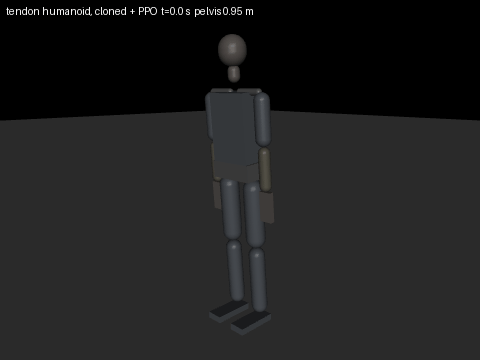
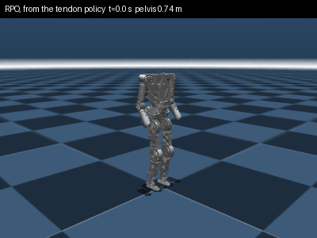

# PPO on a grounded body: the tendon humanoid's stand-in, with the model core as the actor

This is the project's first reward-driven training on a body with contact physics. The body is the tendon
humanoid of [displague/robot](https://github.com/displague/robot) (`humanoid_tendon32`); the learner is PPO;
the policy is the model core, grown from a champion checkpoint to the body's channel counts. Code:
`src/ai_embedded_dynamic_diversity/rl/`.

## The pieces

| Module | What it does |
| --- | --- |
| `rl/standin_env.py` | `StandinEnv`: N copies of the robot repository's fast stand-in (`sim/robot_standin.xml`), stepped together in MuJoCo's multithreaded rollout. Domain randomisation per model variant (servo stiffness down to half for a slack line run, damping, clutch torque, friction, link masses, pelvis mass), actuation delay of 0 to 2 control ticks, the damage gates, and the tasks `stand` and `getup`. |
| `rl/actor.py` | `grow_core`: the champion's core grown to the body's inputs and outputs (new encoder columns at zero, new router rows initialised as the originals were, everything else copied). `CoreActor`: the core as a Gaussian policy, its memory as the recurrent state. `Critic`, `RunningNorm`. |
| `rl/ppo.py` | Recurrent PPO in the rsl_rl recipe: GAE, clipped ratio, KL-adaptive learning rate, truncated backpropagation through each environment's window from its stored memory. |
| `rl/bc.py` | Behaviour cloning from the robot's hand-written controller (demonstrations from displague/robot `tools/record_teacher.py`), before PPO. |
| `rl/tendon_eval.py` | The gate: a trained policy run on the full tendon model, with its line, slack, clutch and power readout, against the hand-written controller on the same pushes. |
| `rl/cli.py` | `train` and `compare` (grown versus random weights, same seed). |

## The stand-in

Each DOF's drive train (motor, self-lock, clutch, drum, two elastic line runs) is one position servo with
the line loop's stiffness, the motor's back-EMF damping and the clutch's slip torque (displague/robot
`tools/export_standin.py`). On 24 cores it runs at about 190,000 control steps per second (50 Hz control, four
5 ms physics steps each), the environment step including observations, rewards and gates at about 76,000;
PPO end to end at about 20,000 samples per second, the rest being the recurrent update on the GPU.

## Damage instead of falling

A policy that is to survive falls cannot have its episodes ended by falling. The gates are what would break
the hardware, from the per-DOF figures the robot repository exports:

- a line above its continuous rating (the force on the loaded run, from the joint torque, the moment arm and
  the pretension) costs in proportion to the excess, and for 2 s continuously ends the episode; the tendon
  model's exit test (0.5 s) is reported;
- an impact on the head, trunk or pelvis shell above 150 N costs, above 1500 N ends the episode;
- a joint pressed into its stop costs in proportion to the stop force.

The W-mini joints (neck, wrists) are excluded from the line gate because they are above their rating standing
still (displague/robot D-023); their overload is reported. In the `stand` task a fall (pelvis below 0.6 m)
also ends the episode.

## Run

```bash
export ROBOT_REPO=../robot          # a checkout of displague/robot with sim/robot_standin.xml
python -m ai_embedded_dynamic_diversity.rl.cli train --task stand --init artifacts/model-core-champion-v09.pt
python -m ai_embedded_dynamic_diversity.rl.cli compare --task getup --checkpoint artifacts/model-core-champion-v09.pt
python -m ai_embedded_dynamic_diversity.rl.tendon_eval artifacts/rl/stand-grown.pt
```

Needs `mujoco` (3.17.0 used) and a CUDA build of torch for reasonable speed.




Render any policy: `python -m ai_embedded_dynamic_diversity.rl.render <policy.pt> --body tendon32|rpo23 --out x.gif`.

## Results: the first ladder (seed 0, 2048 environments, RTX 5080 + 24 CPU cores)

Champion: `artifacts/model-core-champion-v09.pt` (46,876 parameters, 48 inputs, 16 outputs), grown to 104
observations and 32 actions (51,484 parameters). Stand: 150 iterations, 7.4 million steps, about 5 minutes.
Get-up: 500 iterations, 24.6 million steps, about 11 minutes.

| Run | Standing, last 10 iterations | Mean episode | Note |
| --- | --- | --- | --- |
| tendon32 stand, random weights | 45 % | 1.5 s | found 96 % at iteration 37, then lost it |
| tendon32 stand, grown champion | 63 % | 1.9 s | |
| tendon32 stand, grown champion + cloning | **90 %** | **6.0 s** | cloning: 56,903 demonstration steps, 30 epochs, action MSE 0.024 |
| tendon32 getup, grown champion | 0 % | 7.8 s | |
| tendon32 getup, random weights | 0 % | 10.6 s | |

- Cloning from the robot's hand-written controller is the large effect.
- The grown champion ends ahead of random weights on stand, on one seed; not yet a result.
- Get-up was not learned by either. On this robot a flat-footed squat deeper than 0.6 rad of knee tips over
  (the ankle dorsiflexes only 20 degrees), so getting up has to go through kneeling; the task needs a
  curriculum from kneeling, not a drop and a height reward.

**Transfer between bodies.** RPO stand, 150 iterations each:

| Start | Standing, iterations 1 to 10 | Standing, last 10 | Mean episode, last 10 |
| --- | --- | --- | --- |
| random weights | 27 % | 72 % | 1.1 s |
| the tendon32 cloned stand policy | **79 %** | **77 %** | **2.0 s** |

**Forgetting.** Each trained core cut back to the champion's 48 inputs and 16 outputs, scored by
`add-cross-eval` (hexapod, car, drone, polymorph120; mild, gust, force; 2 runs per combination, 90 steps;
`artifacts/rl/cross-eval-forgetting.json`):

| Core | Transfer | Mismatch | Car |
| --- | --- | --- | --- |
| champion v09 | 0.567 | 0.20 | 0.49 |
| getup-grown | 0.569 | 0.21 | 0.49 |
| stand-grown | 0.543 | 0.25 | 0.45 |
| stand-grown-bc | 0.435 | 0.74 | 0.28 |

Learning a body overwrites the old skills in proportion to how much it learns. Promotion of any body-trained
core therefore needs the old cross-eval as a regression gate, and body training needs rehearsal of the old
tasks (or distillation toward the champion on them) alongside it.

**The gate** (`rl/tendon_eval.py`): the cloned policy on the full tendon model falls within 10 s standing
still and at 20 N pushes, and survives 18 of 20 single random pushes; the hand-written controller passes
all of these. The stand-in leaves out the drum locks, the slack line run and the ankle loops' stretch-
for-torque behaviour; closing that gap comes before any of these policies is used on the robot.
