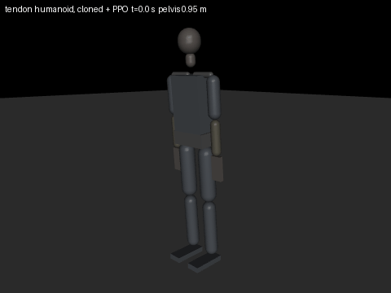
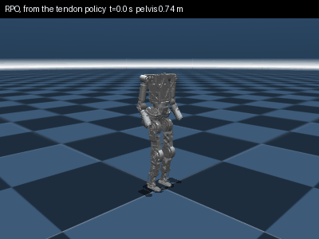
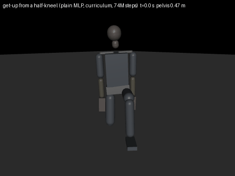
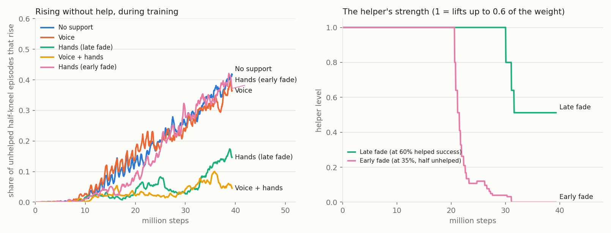
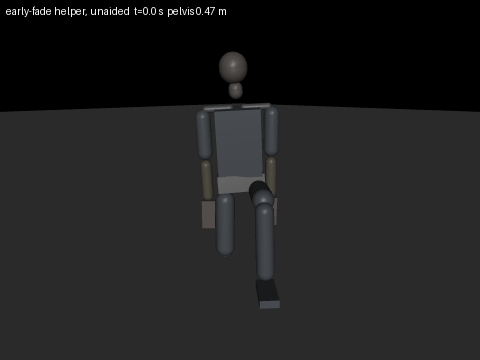
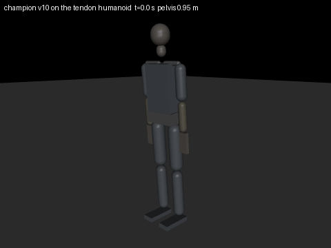

# PPO on a grounded body: the tendon humanoid's stand-in, with the model core as the actor

This is the project's first reward-driven training on a body with contact physics. The body is the tendon
humanoid of [displague/robot](https://github.com/displague/robot) (`humanoid_tendon32`); the learner is PPO;
the policy is the model core, grown from a champion checkpoint to the body's channel counts. Code:
`src/ai_embedded_dynamic_diversity/rl/`.

## The pieces

| Module | What it does |
| --- | --- |
| `rl/standin_env.py` | `StandinEnv`: N copies of the robot repository's fast stand-in (`sim/robot_standin.xml`), stepped together in MuJoCo's multithreaded rollout. Domain randomisation per model variant (servo stiffness down to half for a slack line run, damping, clutch torque, friction, link masses, pelvis mass, optionally wind), actuation delay of 0 to 2 control ticks, the damage gates, and the tasks `stand` and `getup`. |
| `rl/actor.py` | `grow_core`: the champion's core grown to the body's inputs and outputs (new encoder columns at zero, new router rows initialised as the originals were, everything else copied). `CoreActor`: the core as a Gaussian policy, its memory as the recurrent state. `Critic`, `RunningNorm`. |
| `rl/ppo.py` | Recurrent PPO in the rsl_rl recipe: GAE, clipped ratio, KL-adaptive learning rate, truncated backpropagation through each environment's window from its stored memory. |
| `rl/bc.py` | Behaviour cloning from the robot's hand-written controller (demonstrations from displague/robot `tools/record_teacher.py`), before PPO. |
| `rl/tendon_eval.py` | The gate: a trained policy run on the full tendon model, with its line, slack, clutch and power readout, against the hand-written controller on the same pushes (and, with a windy robot checkout, in head winds). |
| `rl/cli.py` | `train` and `compare` (grown versus random weights, same seed). |

## The stand-in

Each DOF's drive train (motor, self-lock, clutch, drum, two elastic line runs) is one position servo with
the line loop's stiffness, the motor's back-EMF damping and the clutch's slip torque (displague/robot
`tools/export_standin.py`). On 24 cores it runs at about 190,000 control steps per second (50 Hz control, four
5 ms physics steps each), the environment step including observations, rewards and gates at about 76,000;
PPO end to end at about 20,000 samples per second, the rest being the recurrent update on the GPU.

## Wind

Off by default. `train` and `compare` take `--wind-mean lo,hi` and `--wind-gust lo,hi` (m/s) and `--wind-tau`
(s, default 2); `EnvConfig` has the same as `wind_mean`, `wind_gust`, `wind_tau`, plus `wind_ramp_s` and
`air_density` (1.2).

The model is the robot's (displague/robot `tools/sim_tendon.py`, `WIND` and `Rig.blow`): MuJoCo's own fluid
model, the inertia-box drag on each body under `opt.density` and `opt.wind` (about 26 N on the 20 kg
humanoid in 10 m/s head on), a mean speed in one direction plus Ornstein-Uhlenbeck gusts on the along-wind
speed (sigma = gust) and the cross-wind speed (0.75 gust) with time constant `wind_tau`.

- The rollout shares each model variant among the envs mapped to it, so the wind is **per variant**: every
  non-nominal variant draws a mean speed, a direction (uniform) and a gust sigma once, and carries its own
  gust state, advanced every control tick before the physics. Variant 0, the nominal model, stays calm.
- The mean ramps in over `wind_ramp_s` from the env's construction, not per episode (episodes on a variant
  start at different times); a reset starts in that variant's current wind.
- The policy observation has no wind channel, as on the robot: the policy has to infer the wind from the
  lean, the feet and the joint loads. With wind on, the privileged observation (the critic's) gains two
  channels at its end, the wind's world x and y speed / 10 m/s, so `priv_dim` grows by 2 only then; with wind
  off everything is bit-identical to before.
- `rl/tendon_eval.py` adds the scenes `wind5` and `wind8` (head wind of that mean, 1.5 m/s gusts, 10 s
  standing) when the robot checkout has wind.
- The robot's teacher data (`tools/record_teacher.py --winds N`) has standing episodes in random winds
  (mean 0 to 9 m/s, gusts 0 to 2 m/s, any direction); `--wind-mean 0,9 --wind-gust 0,2` matches it.

## Damage instead of falling

A policy that is to survive falls cannot have its episodes ended by falling. The gates are what would break
the hardware, from the per-DOF figures the robot repository exports:

- a line above its continuous rating (the force on the loaded run, from the joint torque, the moment arm and
  the pretension) costs in proportion to the excess, and for 2 s continuously ends the episode; the tendon
  model's exit test (0.5 s) is reported;
- an impact on the head, trunk or pelvis shell above 150 N costs, above 1500 N ends the episode;
- a joint pressed into its stop costs in proportion to the stop force.

The W-mini joints (neck, wrists) are excluded from the line gate because they are above their rating standing
still (displague/robot D-023); their overload is reported. In the `stand` task a fall (pelvis below 0.6 m)
also ends the episode.

## Run

```bash
export ROBOT_REPO=../robot          # a checkout of displague/robot with sim/robot_standin.xml
python -m ai_embedded_dynamic_diversity.rl.cli train --task stand --init artifacts/model-core-champion-v09.pt
python -m ai_embedded_dynamic_diversity.rl.cli compare --task getup --checkpoint artifacts/model-core-champion-v09.pt
python -m ai_embedded_dynamic_diversity.rl.tendon_eval artifacts/rl/stand-grown.pt
```

Needs `mujoco` (3.17.0 used) and a CUDA build of torch for reasonable speed.




Render any policy: `python -m ai_embedded_dynamic_diversity.rl.render <policy.pt> --body tendon32|rpo23 --out x.gif`.

## Results: the first ladder (seed 0, 2048 environments, RTX 5080 + 24 CPU cores)

Champion: `artifacts/model-core-champion-v09.pt` (46,876 parameters, 48 inputs, 16 outputs), grown to 104
observations and 32 actions (51,484 parameters). Stand: 150 iterations, 7.4 million steps, about 5 minutes.
Get-up: 500 iterations, 24.6 million steps, about 11 minutes.

| Run | Standing, last 10 iterations | Mean episode | Note |
| --- | --- | --- | --- |
| tendon32 stand, random weights | 45 % | 1.5 s | found 96 % at iteration 37, then lost it |
| tendon32 stand, grown champion | 63 % | 1.9 s | |
| tendon32 stand, grown champion + cloning | **90 %** | **6.0 s** | cloning: 56,903 demonstration steps, 30 epochs, action MSE 0.024 |
| tendon32 getup, grown champion | 0 % | 7.8 s | |
| tendon32 getup, random weights | 0 % | 10.6 s | |

- Cloning from the robot's hand-written controller is the large effect.
- The grown champion ends ahead of random weights on stand, on one seed; not yet a result.
- Get-up was not learned by either. On this robot a flat-footed squat deeper than 0.6 rad of knee tips over
  (the ankle dorsiflexes only 20 degrees), so getting up has to go through kneeling; the task needs a
  curriculum from kneeling, not a drop and a height reward.

**Transfer between bodies.** RPO stand, 150 iterations each:

| Start | Standing, iterations 1 to 10 | Standing, last 10 | Mean episode, last 10 |
| --- | --- | --- | --- |
| random weights | 27 % | 72 % | 1.1 s |
| the tendon32 cloned stand policy | **79 %** | **77 %** | **2.0 s** |

**Forgetting.** Each trained core cut back to the champion's 48 inputs and 16 outputs, scored by
`add-cross-eval` (hexapod, car, drone, polymorph120; mild, gust, force; 2 runs per combination, 90 steps;
`artifacts/rl/cross-eval-forgetting.json`):

| Core | Transfer | Mismatch | Car |
| --- | --- | --- | --- |
| champion v09 | 0.567 | 0.20 | 0.49 |
| getup-grown | 0.569 | 0.21 | 0.49 |
| stand-grown | 0.543 | 0.25 | 0.45 |
| stand-grown-bc | 0.435 | 0.74 | 0.28 |

Learning a body overwrites the old skills in proportion to how much it learns. Promotion of any body-trained
core therefore needs the old cross-eval as a regression gate, and body training needs rehearsal of the old
tasks (or distillation toward the champion on them) alongside it.

**The gate** (`rl/tendon_eval.py`): the cloned policy on the full tendon model falls within 10 s standing
still and at 20 N pushes, and survives 18 of 20 single random pushes; the hand-written controller passes
all of these. The stand-in leaves out the drum locks, the slack line run and the ankle loops' stretch-
for-torque behaviour; closing that gap comes before any of these policies is used on the robot.

## The drive refit and three seeds (issue #48, displague/robot docs/29)

The robot's stand-in was slow and soft against the tendon model: the motor's back-EMF damping sat at the joint
(it acts on the gear, behind the line spring), and nothing reproduced the firmware's outer loop, whose integral
trim takes out the line stretch (a held knee reached 16 % of a target step in 1 s; the tendon model 91 %). The
export now has 0.1 of that damping and a 30 ms target lag, and its JSON carries `outer_loop`, which `StandinEnv`
runs at the control rate (`EnvConfig.outer_loop`, on by default when the spec has it; the lag randomised by
`lag_scale`). With the drum locks gated on whole-body stillness by the robot's balance loop (its D-038), and that
loop off under a policy, no lock engages in the gate, so the locks were not the gap.

Each run: champion v09 grown, cloned from the robot's current teacher data (272 episodes, wind included), 150 PPO
iterations with pushes and `--wind-mean 0,9 --wind-gust 0,2`. Gated with `rl/tendon_eval.py` (S stands):

| Policy | Stand 10 s | 10 N | 20 N | 30 N | Wind 5 | Wind 8 | Random pushes | Standing still |
| --- | --- | --- | --- | --- | --- | --- | --- | --- |
| hand-written controller (`teacher`) | S | S | S | S | S | S | 20/20 | 3.6 W |
| v0.3.0 `stand-grown-bc` | F | F | F | F | F | F | 18/20 (2.5 s window) | 40 W |
| refitted stand-in, seeds 0 / 1 / 2 | S S S | S S S | S F S | F F S | S F F | F F F | 18, 16, 18 | 67, 110, 99 W |
| old stand-in, seeds 0 / 1 / 2 | S S S | S F S | S F S | S F F | F F F | F F F | 17, 17, 18 | 134, 117, 50 W |

Most of the gain over v0.3.0 is the teacher data (re-recorded with the robot's drum locks off while balancing,
and with wind). The refit matches the drive better and its policies score lower on the stand-in itself (83 to 87 %
standing against 89 to 92 %), but on the gate its effect is inside the spread between seeds. Policies:
`artifacts/rl/stand-cascade-bc-s{0,1,2}.pt`, `stand-oldservo-bc-s{0,1,2}.pt` (local, not released).

Left for #48: the 30 N push and the 8 m/s wind, and the power. The policies never let a joint target rest, so the
outer loop never settles; an energy estimate in the reward and a power column in the gate come next, then a
fine-tune on the tendon model itself.

## Five seeds, a plain network, rests and locks (issues #51, #56; displague/robot docs/31)

`--arch mlp` trains a plain two-layer ELU MLP (168 units, 51,440 parameters) instead of the core, through the same
pipeline. Stand, 150 iterations, wind, seeds 0-4, gated on the tendon model with drums allowed to lock:

| Arm | Named scenes per seed (of 6) | Sum of 30 | Random pushes (of 100) | Stand-in standing |
| --- | --- | --- | --- | --- |
| plain network + cloning | 4 4 5 5 4 | 22 | 98 | 0.92 |
| grown champion + cloning | 4 2 4 4 3 | 17 | 89 | 0.86 |
| random core + cloning | 3 4 2 4 0 | 13 | 61 | 0.86 |
| plain network | 3 4 4 4 3 | 18 | 89 | 0.90 |
| grown champion | 0 0 0 0 0 | 0 | 0 | 0.44 |
| random core | 0 0 0 0 0 | 0 | 0 | 0.51 |

The champion's prior beats random weights of its architecture, but a plain network beats both on this body, and
it clones the hand-written controller about 170 times more closely. The core has memory and the MLP none, so
`--arch gru` (a plain 80-unit GRU, 49,872 parameters) was run too: cloned, five seeds, 4 of 6 named scenes on every
seed (20 of 30) and 100 of 100 pushes. Memory is not what the core adds. (The trainer's settings were tuned on
the core.) RPO stand, five seeds: from the tendon policy 0.80
standing in the first 10 iterations on every seed against 0.32 from random weights; at the end 0.76-0.78 on four
seeds against 0.70-0.72, and one seed collapsed to 0.17.

**Rests and locks.** The robot's drums lock when a joint is on target and the body has been still. With
`locks=True` the stand-in carries that rule and the electrical power (`power_cost` charges c log(1 + P / 10 W)).
PPO's exploration noise (4 to 8 degrees per tick) keeps every drum unlocked in training, and training with less
noise (`--init-log-std`, `quiet_noise`) does not transfer to the tendon model. `rl.cli finetune` runs PPO on the
tendon model itself (`rl/tendon_env.py`), where the locks are the real ones, at about 600 control steps per second.
What made policies rest was a scene: a load in one hand (`--hand-load 0,4`), which cut the median idle power over
five seeds from 175 W to 38 W (best 10.6 W, the hand-written controller 5.4 W) and lets 3 of 5 seeds hold a 3.9 kg
bag (5 of 5 with `--quiet 0.5 --episode-s 20`). `tendon_eval <policy> rest [restmode]` runs the rest scenes. (The
held load draws one extra random number per variant, so a run with it randomises the other variant parameters
differently from a run without: the 175 against 38 W compares two different sets of training variants as well.)

## Get-up from a half-kneel (issue #49, displague/robot docs/32)



A two-knee kneel does not rest on this robot: with the shins flat the feet stand on their toes' edge, and with the
knees bent further only the knees touch. A search over 32 half-kneels found one that rests upright (front hip flexed
90 degrees, knee 95, ankle -5; back hip +5, knee 100; pelvis 0.46 m). The robot's static check
(`tools/rise_static.py` there) shows it cannot rise slowly on one leg from below a pelvis height of 0.90 m (the
ankle dorsiflexes 20 degrees), so the rise has to be dynamic.

`--task getup --getup-start curriculum`: start half-kneeling, add fallen starts once the half-kneel succeeds on more
than half of 200+ episodes, and keep half the resets on it (unlocking at a transient success after 50 episodes,
with 15 % rehearsal, unlocked too early and forgot the half-kneel).

| Plain MLP, 1,500 iterations | Rise and stand 1 s (64 starts) | Still standing at 10 s | Worst line / rating | Fallen starts |
| --- | --- | --- | --- | --- |
| seed 0 | 61 % | 28 % | forearms 2.3 | 0 % |
| seed 1 | 55 % | 19 % | forearms 2.3 | 0 % |

`python -m ai_embedded_dynamic_diversity.rl.getup_eval <policy> [--start fallen]` is that test (deterministic, 64
starts, seed 7); it reproduces the table from `gu2-mlp-s0` and `-s1`. The rises are lunges of about half a second.
Not yet: from a fall, on the tendon model, within the arms' ratings.

## A coach for the get-up stages: a voice and a helper's hands (issue #66, displague/robot docs/49)

A physical trainer gives two kinds of support and withdraws both. `rl/coach.py` adds them to the get-up stages:

| Support | What it is | Flags |
| --- | --- | --- |
| **Voice** (hands off) | A coach somewhere around the robot says "stay", then "get up" or "stand up", then cues from what it sees ("lean", "push", "tall", "easy" when a gated line is over its rating) and "good". A word is two or three syllables, each a pattern over 8 frequency bands. Each ear hears it with spreading, the head's shadow, ambient noise and the robot's own drive noise. The observation gains 25 channels: 8 bands per ear, the time difference between the ears, and an 8-band echo of the last second | `--coach voice`, `--coach-guide`, `--coach-wait lo,hi`, `--coach-wait-after` |
| **Hands** | A lift on the trunk: only what the soles leave uncarried, up to a cap, easing off below standing height. A level per start fades as helped episodes succeed and comes back if they stop. Some episodes are never helped, and the helper walks away part-way through others | `--help-cap`, `--help-free`, `--help-quit`, `--help-fade-at` |

No waveform is synthesised: the model is band energies at the control rate. Two bare ears cannot tell front from
back. The ears are sites on the robot's stand-in (`ear.L_pos`, `ear.R_pos`).

### What it measured

Plain MLP, half-kneel curriculum, 800 iterations (39 M steps). Every arm on seed 0; the no-support and early-fade
arms on seeds 1 and 2 as well. The test is `rl.getup_eval`:
64 half-kneel starts, mean action, never with the hands.



| Arm | Rise and stand 1 s | Still standing at 10 s | Ended by a line over its rating | In training |
| --- | --- | --- | --- | --- |
| No support | 48 % | 19 % | 34 of 64 | |
| Voice, cues on every episode (17 channels, before the echo) | 38 % (39 % with the command only, 42 % muted) | 2 % | 26 | The policy does not use the voice: muted, it rises as often |
| Hands, fading at 60 % helped success | 22 % | 2 % | 41 | Full help for 610 of 800 iterations; helped episodes rose 53 %, unhelped 15 % |
| Voice and hands (the same fade) | 14 % | 0 % | 43 | Fallen starts unlocked and their failures brought the help back to full |
| **Hands, fading at 35 %, half the episodes unhelped, a level per start** | **47 %** | **25 %** | **11** | Full help to iteration 419, withdrawn by 632; its impulse fell from 4.3 to 0.13 weight-seconds an episode before it left |

**Waiting for the word was not learned.** Rising before the command is a false start; some episodes are never
told to rise (`--coach-wait 0.5,12` on 10 s episodes).

| Arm | Rises when told | Stays when not told | In training |
| --- | --- | --- | --- |
| The wait from the first step (17 channels) | 0 of 51 | 13 of 13 | Never rose: staying down is safe, and it is what the wait rewards |
| The wait begun once 30 % rise, with the echo (25 channels, 1,200 iterations) | 0 of 52 | 12 of 12 | Rose 27 % before the wait began; then false starts in up to half the episodes, falling to 3 %, and no rise on command |

Both end as a policy that never rises, with the voice or muted. A memoryless network did not learn to tell "stay"
from "get up" in 20 M steps of trying, even with the last second's echo in its inputs.

The two arms that matter, on three seeds (0, 1, 2):

| Arm | Rise and stand 1 s | Still standing at 10 s | Ended by a line over its rating (of 64) | The helper |
| --- | --- | --- | --- | --- |
| No support | 48, 53, 53 %: **52 %** | 19, 5, 16 %: 13 % | 34, 17, 25: 25 | |
| Hands, early fade | 47, 47, 44 %: **46 %** | 25, 13, 3 %: 14 % | 11, 22, 17: 17 | Withdrawn in training on every seed (by iteration 632, 621, 736) |

| An unaided get-up after the early-fade helper (seed 0) |
| --- |
|  |

What it shows (the other arms are one seed each, so only their large gaps count):
1. **Help that stays becomes the skill.** With the late fade, the policy rose 53 % of the time with the hands and
   22 % without. This is the dependence the robot's withdrawal laws (its D-069) were written against.
2. **Help that leaves early can be withdrawn, at a small cost and no gain.** Over three seeds the early fade
   rises 46 % against 52 % with no support (lower on every seed), is still standing as often (14 % against 13 %),
   and ends fewer episodes by overloading a line (17 against 25 of 64; on two seeds of three). The helper is gone
   before the end on every seed, so the withdrawal law is met in training, not only in the test. Seed 0 alone
   suggested it cost nothing and cut overloads to a third; the other two seeds did not bear that out.
3. **Spoken cues were not used.** Without a wait the voice carries nothing the policy needs, and 17 more noisy
   inputs cost some rise rate at equal steps. A simple listener (the nearest word by long-term spectrum) names the
   word 69 % of the time at 3 m with the robot still, 46 % with the joints at 0.5 rad/s and 15 % at 2 rad/s (chance
   is 11 %): a robot that is lunging hears little. The side the voice comes from stays readable (98 % at 3 m and
   2 rad/s).
4. **Obeying a spoken command is not learned yet.** Staged or not, the wait ends in staying down. The next
   things to try are a recurrent policy (`--arch gru`), a reward that does not pay more for kneeling than for a
   failed rise, and a start where staying down is not an option (standing, with "sit" and "stand").

Not yet: more seeds; the fallen starts (0 % in every arm); the tendon gate (it computes its observation from the
rig and has no ears yet); "come here"; a recurrent policy, which is what words that take time really call for.

## Eyes, a trainer to watch, and cross-training (issue #73, displague/robot docs/50)

The coach of #66 was heard and not obeyed. This adds sight, a trainer's body to look at, the same eyes in the
cellular world, and tools to move a core between that world and the grounded bodies.

| Piece | What it is | Flags |
| --- | --- | --- |
| **Eyes** (`rl/vision.py`) | A pair of eyes 60 mm apart, each a wide coarse periphery (5 x 3 over 120 x 72 degrees, brightness) with a narrow fine fovea overlaid (3 x 3 over 24 degrees: brightness, red against green, blue against yellow), and a third eye that reads range (4 x 3 over 80 x 60 degrees). Receptor responses are computed from the scene's geometry on the GPU (7 ms for 2,048 robots); nothing is rendered. Colour's noise grows as the light falls; range does not depend on the light | `--eyes pair`, `third`, `three` |
| **Trainer** (`rl/coach.Figure`) | A body in front of the robot, drawn as balls at a skeleton's keypoints. It waits low, rises at the command and paces the learner. Its motion is the robot's hand-written get-up recorded on the full tendon model (`demo`), the stand-in's (`tendon32`), Roboparty's RPO (`rpo23`: an open robot instructing), or a squat (`squat`) | `--trainer`, `--trainer-arc` |
| **Mirror task** | Start standing; the trainer squats to changing depths and the pelvis is paid for following | `--task mirror --trainer squat`, `rl.mirror_eval` |
| **Eyes in the cellular world** (`sim/world.py`) | The same layout on the world's fields, in observation slots 28 to 47: life as brightness and resource channels as colour where the light falls, stress for the third eye. Off by default | `ADD_WORLD_EYES=1` |
| **Cross-training** | Evolve in `new_env_v1` from any seed checkpoints and score them over many evaluation seeds; hold a grown core's old weights near the champion while it learns a body; continue a policy as a second stage | `scripts/cross_train.py`, `--anchor`, `--finetune` |

Controls for the tests: `rl.getup_eval --hide` (the trainer gone, its script still running), `--shut` (eyes
closed), `--light 0.02,0.02` (near dark).

### What a simple reader can tell from one frame

A linear fit, the trainer 1.2 to 3 m away, the robot in the half-kneel:

| Eyes | Trainer within | Light | Trainer up or waiting (chance 50 %) | Its side | Distance error, m (0.44 guessing) |
| --- | --- | --- | --- | --- | --- |
| Pair | 15 degrees | Day | 95 % | 95 % | 0.25 |
| Pair | 15 degrees | Near dark | 77 % | 80 % | 0.38 |
| Third | 15 degrees | Day or near dark | 91 % | 94 % | 0.24 |
| Three | 15 degrees | Day | 97 % | 96 % | 0.19 |
| Three | 15 degrees | Near dark | 93 % | 94 % | 0.22 |
| Three | 40 degrees | Day | 89 % | 95 % | 0.26 |

The same reader recovers a squat's depth with a correlation of only 0.40: a 9 cm drop is below what this fovea
resolves at that distance.

### What it measured

Plain MLP, 2,048 robots, the policy's mean action in every test.

**Waiting for a command before getting up** (seed 0; shown by the trainer with three eyes, or spoken):

| Design | Shown: rises when told / false starts | Spoken: rises when told / false starts |
| --- | --- | --- |
| 1. The wait begins once the rise is learned | 10 % / 53 % | 0 % / none (#66) |
| 2. The wait from the first episode, the clock starting at the command | 0 % / 0 % | 0 % / 2 % |
| 3. The script from the first episode, the wait enforced once the rise is learned | 0 % / 45 % | 7 % / 44 % |
| 4. Design 3, then a false start forfeits the rise's pay (`--finetune`) | 0 % / 0 % | 0 % / 0 % |

Three faults in the task were fixed on the way (all three are now how the environment works):
1. A wait ate the time a rise pays back in. The episode now runs `episode_s` from the command.
2. The trainer waiting low, and the word "stay", were new on the day the wait began. The script now runs from the
   first episode, and `coach_wait_after` only decides when a rise before the command stops being paid.
3. Rising early and standing through the command paid best. A false start now forfeits the rise's pay and does not
   count as a success.

None was enough. Once any rise can be punished, not rising is the safe policy: the rise succeeds about half the
time and a third of episodes end on an overloaded line. The shown command needs no memory and fails as the
spoken one does, so #66's reading (a memoryless policy cannot hold a word) is not the whole cause.

**The mirror task** (seeds 0 and 1, 1,300 iterations, 64 robots for 20 s):

| Test | Height error, seed 0 / 1 | Just standing still | Follows the trainer (correlation) | Fell, of 64 |
| --- | --- | --- | --- | --- |
| As trained | 0.019 / 0.020 | 0.019 / 0.019 | 0.02 / 0.03 | 3 / 12 |
| Trainer hidden | 0.019 / 0.019 | 0.019 / 0.018 | 0.00 / 0.03 | 7 / 11 |
| Eyes shut | 0.022 / 0.025 | 0.021 / 0.022 | -0.02 / -0.01 | 15 / 42 |

It did not follow: both policies hold one height, the best a robot that cannot see the trainer can do. The squat
is not readable on this retina (above), so this is a limit of the eyes, not of the learning.

**Two eyes on the plain get-up** (seed 0, 800 iterations): 45 % unaided rise against 52 % without eyes (three
seeds); with its eyes shut the policy never rises. It relies on them and gains nothing.

**Evolution in the cellular world** (`scripts/cross_train.py`; three evolutions an arm, 40 generations of 6; fitness
on `new_env_v1` over 16 evaluation seeds, one evaluation's spread about 0.006):

| Arm | By seed | Mean |
| --- | --- | --- |
| `model-core-champion-v09`, not evolved further | | 0.0176 |
| Evolved from it | 0.0231, 0.0182, 0.0154 | 0.0189 |
| Evolved from it with the world's eyes, scored without them | 0.0239, 0.0224, 0.0164 | 0.0209 |
| The same three, scored with the eyes | 0.0209, 0.0184, 0.0149 | 0.0181 |
| Evolved from it, `cut-stand-grown` and `cut-getup-grown` (cores a body trained in MuJoCo) | 0.0223, 0.0168, 0.0171 | 0.0187 |

No arm beats the champion beyond the spread between seeds. The champion is unchanged.

Not yet: `--anchor` is not measured; `--body rpo23` as the learner with the trainer and the hands only
smoke-tested; no second open robot; the tendon gate has no eyes or ears (#70).

## Champion v10: a core that keeps its world and comes with a body (issue #79, displague/robot docs/51)

`model-core-champion-v10` is the first champion chosen on both sides: the cellular world it evolved in, and the
tendon humanoid in MuJoCo. It ships with the humanoid's roots, so it stands on the stand-in and on the full tendon
model without further training.

### Roots

Until now a champion was grown onto a body by widening its first layer and its router, and the body's joints fed
the same input columns the cellular world used. Learning the body overwrote the world.

`rl/actor.RootedCore` (`--roots`) gives the body input columns and router rows of its own, beside the champion's.
The champion's own columns see zero and its own rows are not read, so only the trunk between them is shared.
`rl/cut_back.py` cuts the roots off and keeps them in the core file (`bodies`); `embody` puts them back, on that core
or another; `pack` writes a champion file with a body.

How much of the trunk may move while the body is learned (seed 0; cloning the hand-written controller, then 150 PPO
iterations with pushes and wind; the world as the paired fitness difference from v09 over 32 evaluations, standard
error about 0.002):

| Trunk | Weight change | World: legacy / `new_env_v1` | Tendon gate: named scenes of 6, random pushes of 20 |
| --- | --- | --- | --- |
| Free (`--anchor 0`) | 7.2 % | -0.091 / -0.045 | 3, 15 |
| `--anchor 30` | 3.2 % | -0.039 / -0.027 | 0, 10 |
| `--anchor 1000` | 0.3 % | -0.013 / -0.012 | 3, 16 |
| Frozen (`--freeze-trunk`) | none | 0 / 0 | 2, 18 |

The world is lost faster than the body is gained: a trunk that moved 0.3 % already scores 0.012 lower, seven
standard errors, and stands no better than a frozen one. So the trunk is frozen while a body is learned, and the
body's part in the evolution is selection: which evolved trunk carries the body best.

### Selection

1. **World.** Nine cores evolved from v09 in PR #74 (40 generations of 6) were re-scored with the paired measure
   (`scripts/cross_train.py score`: every checkpoint on the same worlds, controls and noise). Three beat v09. A
   second generation evolved from those three gave one more (`g2-s11`; on the body it is worse, below).
2. **Body.** Each of the three had roots trained on its frozen trunk, two seeds, and was run through the tendon
   gate (`rl.tendon_eval`: the full tendon model, six named scenes and 20 random pushes).
3. **Confirmation.** The leader and v09 got three more seeds each, and the world score a fresh set of 48
   evaluation seeds.

| Core | World, fresh seeds: legacy / `new_env_v1` (standard error) | Gate, named scenes by seed | Random pushes by seed |
| --- | --- | --- | --- |
| v09 | 0 / 0 | 2, 2, 1, 1, 2: **8 of 30** | 18, 18, 5, 17, 16: **74 of 100** |
| `evo-a-s1`, now **v10** | +0.018 (0.001) / +0.0068 (0.0011) | 3, 2, 2, 3, 2: **12 of 30** | 20, 18, 18, 19, 18: **93 of 100** |
| `evo-a-s2` | +0.034 / +0.001 | 2, 2 | 19, 18 |
| `evo-c-s1` (seeded with MuJoCo-trained cores) | +0.032 / +0.003 | 2, 2 | 18, 1 |

- v10 is at least as good as v09 on every seed, and on the three seeds run after it was picked it passes 7 named
  scenes against 4 and 55 pushes against 38.
- Cross-eval (4 embodiments, 3 scenarios, 6 runs each): v10 0.574, v09 0.567.
- The promotion rule was written in #79 before these numbers: the world not lower, the gate higher. Both hold.

| Champion v10 standing on the tendon humanoid's stand-in, pushed (its own roots, no further training) |
| --- |
|  |

### Longer roots training, the open robot, and the second generation (issue #82)

The runs that #81 left open, one at a time.

**1. 300 more PPO iterations on the frozen trunk** (`--finetune` from each seed's roots, `--critic-warmup 20`, the
same pushes and wind), five seeds a side:

| Core | Named scenes by seed | Random pushes by seed | Holds the 30 N push | Power standing still, by seed |
| --- | --- | --- | --- | --- |
| v09 | 3, 3, 3, 3, 3: **15 of 30** | 20, 20, 19, 19, 20: **98 of 100** | 0 seeds of 5 | 17, 15, 47, 105, 55 W |
| **v10** | 4, 4, 4, 3, 4: **19 of 30** | 20, 20, 19, 20, 20: **99 of 100** | 4 seeds of 5 | 73, 44, 23, 164, 39 W |

- Longer training helps both cores (v10 from 12 to 19, v09 from 8 to 15), and v10 keeps its lead of four scenes.
- The difference is one scene: the 30 N push. Both winds fail on every seed of both cores.
- The random pushes no longer separate them.

**2. The champion's body is now seed 1's longer-trained roots** (release v0.6.1): 4 of 6 named scenes, 20 of 20
pushes, 44 W. The trunk is the same, bit for bit (`pack` refuses any other).

**3. The open RPO robot** (`--body rpo23 --roots --freeze-trunk`, 150 iterations, no demonstrations, two seeds):

| Core | Standing fraction at the end, by seed | Whole episodes stood |
| --- | --- | --- |
| v09 | 0.72, 0.69 | none |
| v10 | 0.73, 0.71 | none |

No difference to speak of, and neither stands: roots alone on a frozen trunk, without a teacher, do not learn RPO
in 150 iterations. Whether the better trunk for the tendon humanoid is better for another robot is not answered.

**4. The second-generation core `g2-s11`** (better than v10 in the legacy world): 2 of 6 named scenes on both seeds
(it loses the 20 N push), 19 and 18 pushes. Worse than v10 on the body, so it is not promoted. Being better in the
world does not make a trunk better for the body.

### What v10 is, and is not

- **Its trunk is evolution's.** It came from coevolution in `new_env_v1` from v09 (seed 1). Cloning and PPO trained
  only its roots, and chose it among its siblings. No gradient from the body reached the trunk.
- **Its body** (`bodies["tendon32"]`): the roots of seed 1, trained 150 and then 300 more iterations (v0.6.1; v0.6.0
  shipped seed 0's 150-iteration roots: 3 of 6, 60 W). On the tendon gate: stands 10 s, holds 10 N, 20 N and 30 N
  pushes, fails both winds, 20 of 20 random pushes, 44 W standing still.
- **It is not the best controller for this robot.** A plain network with the same cloning passes 22 of 30 named
  scenes and 98 of 100 pushes, and the hand-written controller all of them. v10 is the best *champion* on the body.
- **Not ready for every test.** Both winds fail on every seed. The get-up was not tried with the core. On the open
  RPO robot its roots did not learn to stand (above).

```bash
python -m ai_embedded_dynamic_diversity.rl.cut_back embody artifacts/model-core-champion-v10.pt tendon32 v10-tendon32.pt
python -m ai_embedded_dynamic_diversity.rl.tendon_eval v10-tendon32.pt          # the gate, on the full tendon model
python -m ai_embedded_dynamic_diversity.rl.render v10-tendon32.pt --task stand  # a clip on the stand-in
```
